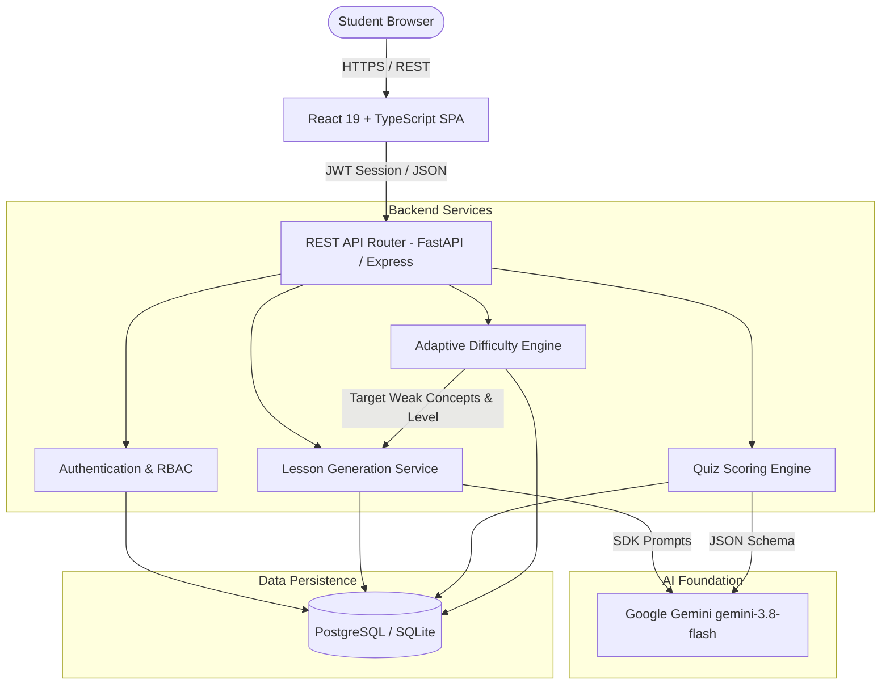
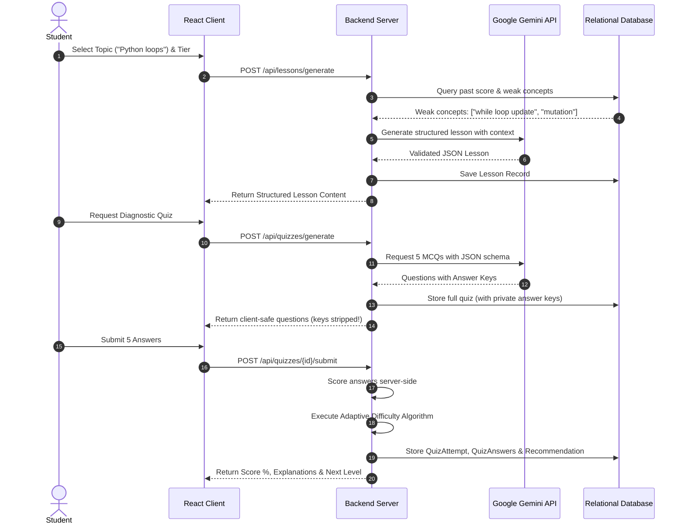

# LearnWise AI — System Architecture & Academic Report

## 1. Abstract
LearnWise AI is an adaptive, AI-based personalized educational content generator designed for third-semester Artificial Intelligence and Machine Learning students and self-directed learners. Traditional educational media is static and homogeneous, unable to adjust to varied learning speeds or diagnose concept-specific knowledge gaps. LearnWise AI implements a closed-loop mastery framework: **LEARN → PRACTICE → EVALUATE → ADAPT → LEARN AGAIN**. By utilizing Google Gemini (`gemini-3.8-flash`), server-authoritative diagnostic scoring, and deterministic threshold-based adaptive progression, the system dynamically tunes the depth, language, and complexity of generated educational materials.

---

## 2. Problem Statement & Motivation
In contemporary higher education:
1. **One-Size-Fits-All Content**: Novices struggle with ungrounded technical jargon, while advanced learners face boredom from trivial explanations.
2. **Disconnected Evaluation**: Quizzes typically serve as summative terminal checks rather than formative drivers of subsequent content generation.
3. **Inspect-Element Vulnerabilities**: Many web-based learning tools expose quiz answer keys to the frontend before submission, undermining evaluation integrity.

---

## 3. System Architecture

---

## 4. The Mastery Data Flow

---

## 5. Technology Stack Rationale

| Layer | Selected Tech | Rationale |
| :--- | :--- | :--- |
| **Frontend** | React 19, TypeScript, Vite, Tailwind CSS, Lucide | Instant reactivity, strict type safety, zero-bundle overhead, and academic clean UI. |
| **Progress Charts** | Recharts | Canvas/SVG charting of score history and topic mastery over time. |
| **Backend** | Python FastAPI & Express Node.js | FastAPI provides asynchronous high throughput, automatic OpenAPI documentation, and Pydantic validation. |
| **Database** | PostgreSQL + SQLAlchemy ORM | ACID transactional integrity, normalized schema, and foreign-key cascades. |
| **AI Model** | Google Gemini `gemini-3.8-flash` | Low latency, high reasoning quality, and strict JSON schema generation capability. |

---

## 6. Limitations & Future Enhancements
- **Current Limitations**: Focuses on text and runnable code snippets; interactive live execution sandboxes (e.g. WebAssembly Pyodide) are future additions.
- **Future Enhancements**: Multi-agent peer debates, automated generation of unit test suites, and spaced-repetition notification schedulers.
