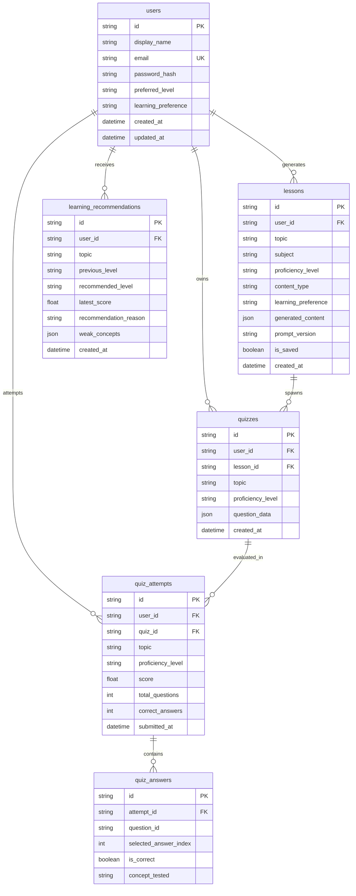

# LearnWise AI — Relational Database Schema & Migrations

LearnWise AI employs a third-normal-form (3NF) relational database schema supported natively in PostgreSQL (production/docker) and SQLite (zero-setup local development).

---

## 1. Entity-Relationship Model

---

## 2. Security Safeguards in Data Storage
1. **Password Protection**: Passwords are never stored plaintext; they are hashed with salted bcrypt or sha256 algorithms.
2. **Hidden Answer Keys**: `quizzes.question_data` contains the authoritative `correctAnswerIndex`. When the client requests `GET /api/quizzes/{id}`, the backend dynamically strips this property before sending the payload.
3. **Foreign Key Cascade Deletion**: Deleting a user account cascades to all associated lessons, quizzes, attempts, and recommendations.
